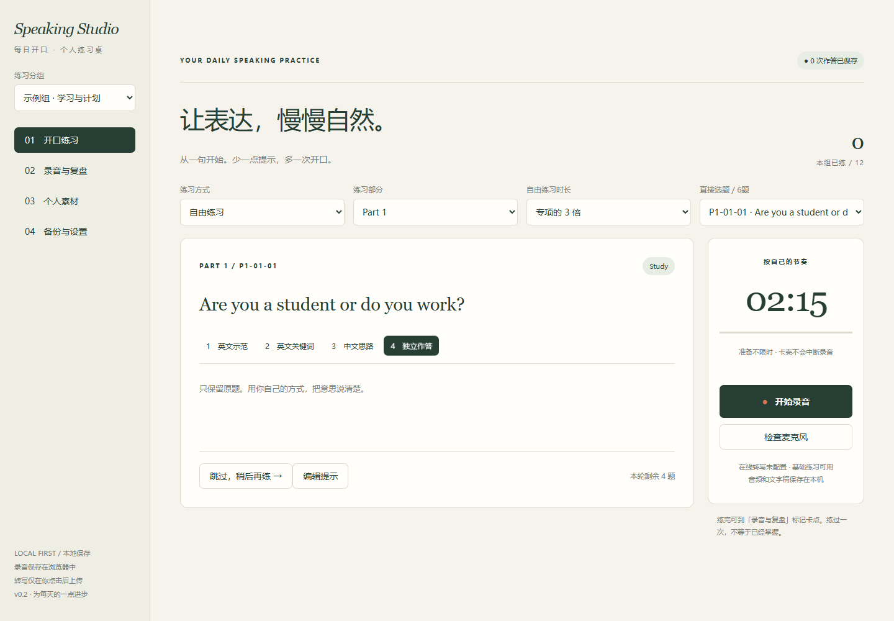

# Speaking Studio · 每日开口

供个人使用的本地口语练习网站：按天分组抽题，通过四级提示逐步脱稿，录音、回听、复盘，并按需转写。

**项目分组：个人工具／学习辅助。当前版本：v0.3.0。**

公开仓库附带 **12道合成示例题**，用于演示功能；它们不是官方题库，也不代表作者真实经历。个人完整题单、个人故事、录音、练习进度和服务凭据不随仓库发布。



## 手机在线版

新增 [online/](online/) 源码，可部署为仅本人登录访问的HTTPS站点。录音保存到R2、进度及文字稿保存到D1；手机联网即可使用，电脑不必开机。在线版不替换本地版，也不自动上传电脑已有录音。迁移时先在本地导出完整备份，再在自己的在线版合并恢复。

公开仓库仅提供合成示例，不包含作者私人站点身份、完整题包或云端数据。

## 本地运行

需要 Node.js 22及以上，本次验证环境为 Windows + Node.js 24.13.0 + Microsoft Edge。

Windows：双击 **启动口语练习.cmd**。它会启动服务并打开 **http://localhost:8765**；保持窗口开启，按 Ctrl+C 停止。重复启动会打开已运行的实例。

其他系统或命令行：

```sh
npm start
```

基础功能只使用 Node.js 和浏览器已有能力，**运行网站不需要 npm install，也不依赖外部 CDN**。`npm ci` 仅用于安装开发测试工具。

## 功能

- 每日分组、Part 1/2/3题库；一轮内抽题不重复，也能直接选题。
- Level 1英文示范、Level 2英文关键词、Level 3中文思路、Level 4仅保留原题；自由选择，同题重练。
- 自由练习不限准备时间，回答上限取专项的2或3倍，默认3倍。沉默不会提前停止。
- 限时专项准备结束自动录音；完整模拟连续完成三个Part，Part 3关联本轮Part 2。题量不足会明确标记缩短模拟。
- 自动选择浏览器支持的录音格式；保存各次录音、提示查看标记、笔记和掌握状态。
- 录音回放、下载、逐题提示编辑、个人素材编辑，以及包含真实音频的完整备份和合并恢复。
- 可配置在线录后转写：用户点击才上传，结果在后台处理并归到原录音，可修改、导出、失败重试。

| 部分 | 专项准备 | 专项回答上限 | 自由练习默认上限 |
| --- | --- | --- | --- |
| Part 1 | 5秒 | 45秒 | 2分15秒 |
| Part 2 | 1分钟 | 2分钟 | 6分钟 |
| Part 3 | 10秒 | 1分钟 | 3分钟 |

这些是训练设置。完整模拟另按Part 1/3各最多4分30秒、Part 2准备1分钟和回答最多2分钟控制，不给Part 1/3额外固定准备时间。

## 两种保存方式

在「备份与设置 → 保存方式」选择：

**电脑文件夹保存（默认）**：

- `data/store.json` 保存题库、进度、笔记、文字稿和录音索引。
- `data/audio/` 保存实际音频。内容去重；累计录音草稿滚动覆盖，正式录音独立保存。
- `data/backups/` 保存最近30版元数据快照。写入采用临时文件、落盘和替换；版本冲突拒绝覆盖；损坏时尝试恢复有效快照，缺少音频不会被当作空库初始化。

清理浏览器数据或重启电脑不会删除这些电脑文件。浏览器偏好被清理后重新采用默认的电脑文件夹方式。

**浏览器保存（原方式）**：保留 IndexedDB 作为可选方案。该模式按浏览器和网址独立保存，清理网站数据会清除本模式的记录。

两边数据分别保留：首次切换到空目标时复制当前数据；目标已有数据则打开目标原来的记录。电脑端为空时自动复制旧浏览器数据且保留原记录；电脑端非空时可手动合并迁移。

请尽量在一个活动窗口练习。保存失败时先用救援入口重试或下载音频，再刷新。备份时导出完整包到另一块磁盘，或关闭服务后复制整个 `data` 文件夹；同盘自动快照不等于异地备份。

## 自己的题库

程序优先读取 `public/bank.json`；缺少它时自动使用 `public/bank.sample.json`。前者被 Git 忽略，后者为可公开的合成示例。

参考示例的 `questions`、`groups`、`materials` 结构整理自己的题库。题号须稳定，Part 2保留完整四条提示，Part 3的parent指向关联题卡。首次启动会导入题库；已有练习数据不会被文件变化静默覆盖，更新题库可通过完整备份恢复与逐题编辑处理。

本机针对私有资料的转换器与原始Markdown材料不公开。公开版本直接使用示例JSON格式准备自己的题库，无须转换脚本。

## 可选在线转写

将 `.env.example` 复制为 `.env`，填写 `STT_URL`、`STT_MODEL` 和 `STT_KEY`，再重启服务。

适配接口使用Bearer认证，接收multipart字段file/model/language，返回JSON中的text字符串。支持所选浏览器的WebM、OGG或MP4录音；若供应商只接收WAV，还需增加转码适配。凭据只在本地服务端使用，不进入导出备份。

**当前没有真实服务凭据，云服务尚未完成端到端联调。** 未配置时仍能正常练习、录音与备份。费用和可用性由所选服务决定。

## 验证与边界

```sh
npm ci
npm test
npm run test:browser
```

核心及文件保存自动测试11项，另有2项公开示例检查；浏览器回归使用独立临时目录，不写用户数据。浏览器脚本使用本机Edge；其他系统需调整测试浏览器路径。检查包括录音持久保存、提示隐藏、专项计时、模拟推进、备份恢复、保存失败救援、多标签保护、两种保存方式、浏览器清理、迁移和服务重启。

测试使用浏览器测试音频与模拟转写响应，不代表真实麦克风听感、真实云服务或实际手机录音已经验收。当前服务仅监听本机，手机布局适配不等于已经配置手机访问入口。详见 [验证记录](VERIFICATION.md)。

## 目录

```text
public/             页面、练习逻辑、两种保存适配器、合成示例题库
disk-store.mjs      电脑文件保存、音频与快照
server.mjs          本地静态服务、保存接口、可选转写代理
tests/              核心、文件系统和浏览器回归
scripts/            公开发布内容检查工具
start.ps1           Windows启动入口
```

## 来源与贡献

个人学习工具：训练流程与需求由作者提出，代码在AI编程助手协助下实现。以下项目提供了设计思路参考，未直接复制其实现代码：

- [TuuuuTuu/ielts-speaking-practice](https://github.com/TuuuuTuu/ielts-speaking-practice)：题目与个人素材关联、备份合并恢复。
- [tutuhua/IELTS-Speaking-Lab](https://github.com/tutuhua/IELTS-Speaking-Lab)：故事与多个题卡映射。
- [RajBarshikar/IELTS_speaking](https://github.com/RajBarshikar/IELTS_speaking)：录音格式能力检测、独立转写与后台归档。

本项目是个人训练工具，不隶属于IELTS，不提供官方题库或官方评分。第三方依赖保留各自许可；本仓库未声明覆盖第三方材料的统一许可。
